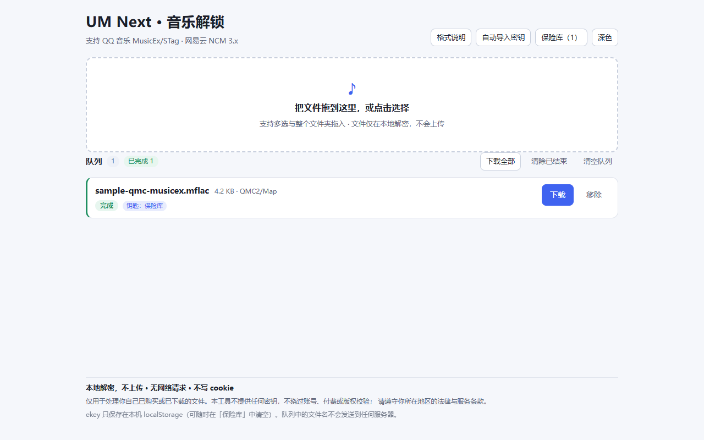
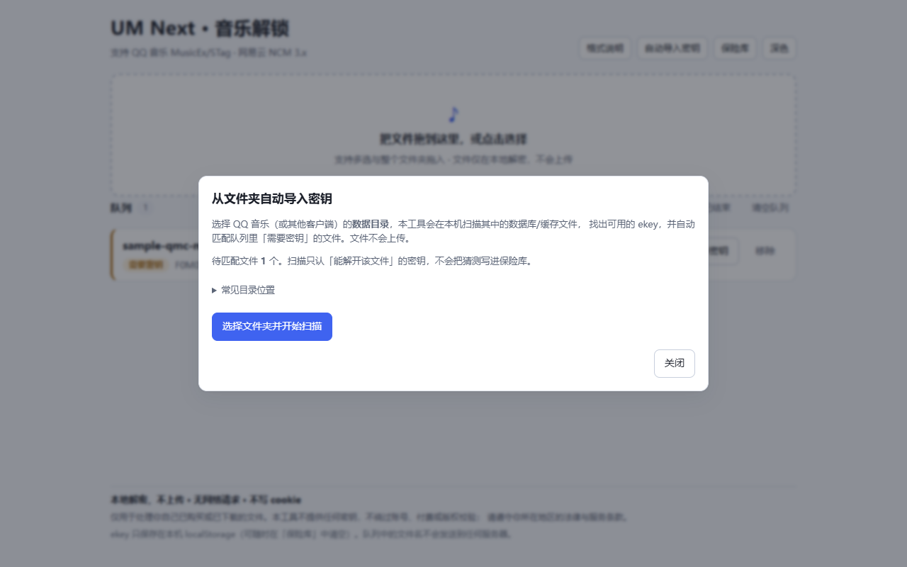

# UM Next · 音乐解锁

纯前端、可离线运行的 QQ 音乐 / 网易云音乐格式转换工具。所有解密都在浏览器本地完成，文件与密钥不会上传到任何服务器。

[](#测试)
[](LICENSE)



## 功能

| 来源 | 格式 / 尾部 | 行为 |
|---|---|---|
| 网易云音乐 | NCM（含 3.x） | 自动解密；无封面、无元数据、CRC 不匹配只告警 |
| QQ 音乐 | QMC1（`qmc0/3/flac/ogg/2/6/8`、`tm*`、`tkm`） | 自动解密（128 字节静态密钥） |
| QQ 音乐 | QMC2 + `PCv1Legacy` / `AndroidQTag` | 自动解密（密钥内嵌在尾部） |
| QQ 音乐 | **QMC2 + `MusicEx`（PC ≥ 19.57，含 22.x）** | 识别为「需要密钥」，补 ekey 后解密并按歌曲记住 |
| QQ 音乐 | **QMC2 + `STag`（Android ≥ 10.12）** | 同上 |
| 明文音频 | flac / mp3 / ogg / m4a / wav / ape / wv / dsf | 原样透传并修正扩展名 |

其他能力：

- **ekey 保险库**：粘贴一次，按 `media_filename` → `mid` → 本地文件名逐级匹配；支持批量导入 `标识,ekey`、导出 JSON、一键清空。
- **从文件夹自动导入密钥**：选择一个本地目录（如 QQ 音乐数据目录），自动提取候选、用 tc_tea 自证、再用「能否解开目标文件头」配对；匹配成功才写入保险库并自动重排解密。
- **批量队列**：进度、取消、重试、单个/全部下载，输出命名 `歌手 - 标题.ext`，封面可单独导出。
- **纯本地**：0 外部请求、不写 cookie、无 `eval`；Worker 分块解密，主线程不卡顿。
- **旧设备兼容**：构建目标 Safari 12，兼容 **macOS 10.14.6**（Mojave）与 Chrome 80+；Worker 使用经典模式（Safari 15 以下不支持 module worker）。



## 快速开始

需要 Node.js ≥ 18。

```bash
npm install
npm run dev        # 开发
npm run build      # 生成 dist/
npm run preview    # 本地静态预览（零依赖服务器）
```

`dist/` 是纯静态产物（`base: './'`），可直接放到任意静态服务器、对象存储或本地打开预览。

## 使用

1. 把加密音频拖进页面（支持多选与文件夹）。
2. 旧格式会直接解密；新版 QQ 音乐文件会提示「需要密钥」。
3. 点「从文件夹自动找密钥」扫描客户端数据目录，或手动粘贴 ekey（支持 `QQMusic EncV2,Key:` 前缀）；成功后按歌曲记住。
4. 解密完成后下载；批量可点「下载全部」。

> ekey 与账号和歌曲绑定，需要你自行从已登录、已购买/已下载的客户端环境中获取。本项目**不提供、不内置、不抓取任何密钥或账号凭证**。

## 兼容性

- Chrome / Edge 80+
- Firefox 78+
- Safari 12+（macOS 10.14.6 可用的 Safari 14.1 已实测）
- 不需要 WebAssembly、不需要网络

## 技术实现

- `src/core/`：纯 TypeScript 内核，无 DOM 依赖
  - `qmc/qmc1.ts`、`qmc/qmc2.ts`：静态密钥、`key_compress`、Map / RC4 变体、分块偏移语义
  - `qmc/ekey.ts`：ekey v1 / v2（两轮 tc_tea）
  - `qmc/footer.ts`：`STag` / `QTag` / `MusicEx` / `PCv1Legacy`
  - `ncm/`：NCM 头、AES-128-ECB 密钥与元数据、封面、音频流
  - `tea.ts` / `aes128.ts`：腾讯 TEA 与 AES 的纯 TS 实现（浏览器 WebCrypto 不支持 ECB）
  - `ekeyScan.ts`：目录扫描的候选提取、算法自证与文件头配对
- `src/worker/`：解密与扫描两个 Worker，4 MiB 分块 + 进度节流
- `src/ui/`：React 19 + 手写 CSS，无 UI 框架、无外部字体

## 测试

```bash
npm test           # vitest：237 个用例
npm run selfcheck  # 内核自检：122 项断言（含上游公开测试向量）
npm run samples    # 生成 6 个合成样本到 .tmp/samples/
```

测试样本全部为**自建合成容器**（4 KiB 合成音频），不含任何版权内容。

## 项目结构

```
src/core/       解密内核（纯 TS）
src/worker/     解密 / 扫描 Worker
src/ui/         React 组件
src/store/      队列、保险库、下载
tests/          单元测试与合成样本
scripts/        自检、样本生成、静态服务器
```

## 法律与免责声明

- 本项目仅用于**格式转换**：把你已经合法购买/下载、且仅用于个人收听的文件转成通用格式。
- 本项目不提供密钥，不绕过账号、付费或版权校验，不包含任何破解服务端。
- 请遵守你所在地区的法律与音乐服务的使用条款；因使用本项目产生的后果由使用者自行承担。

## 致谢

QMC / NCM 的格式研究来自开源社区。本项目的算法实现参考了 [Unlock Music Project](https://git.unlock-music.dev/um)（`um-react`、`lib_um_crypto_rust`，Apache-2.0 / MIT）公开的格式说明与测试向量，代码为独立的 TypeScript 重实现，未复制其源码。TEA 实现遵循 `tc_tea` 的公开规范。

## License

[MIT](LICENSE) © 2026 glaypan
